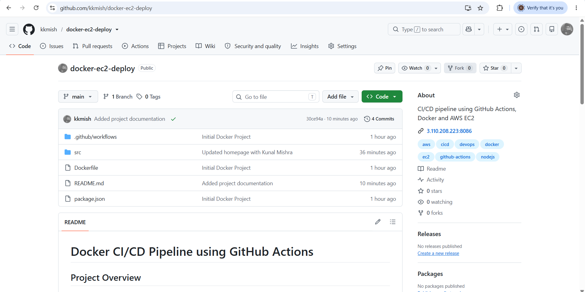
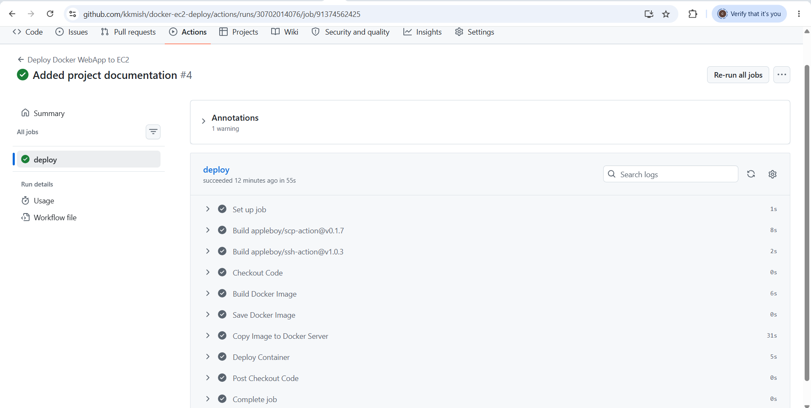
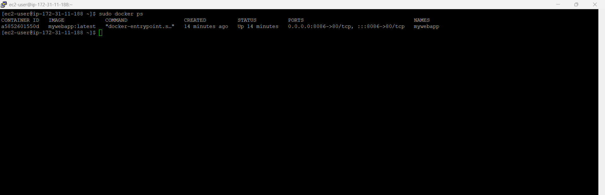
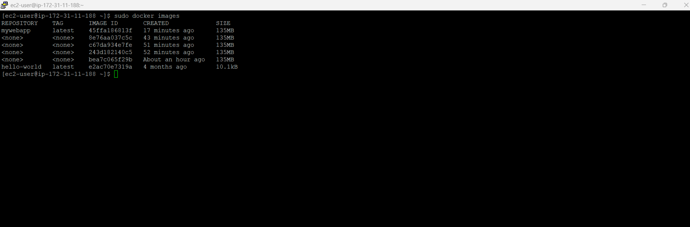
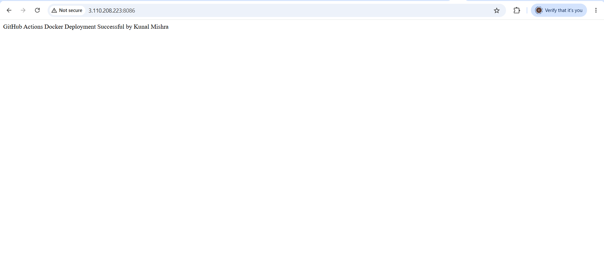

# Docker CI/CD Pipeline using GitHub Actions

## Project Overview

This project demonstrates an automated CI/CD pipeline using GitHub Actions, Docker, and AWS EC2.

Whenever code is pushed to GitHub, GitHub Actions automatically:

- Builds a Docker image
- Copies the image to an AWS EC2 instance
- Stops the old container
- Deploys the latest Docker container
- Makes the updated application available automatically

The application is a simple Node.js web application running inside a Docker container.

---

## Technologies Used

- Git
- GitHub
- GitHub Actions
- Docker
- AWS EC2
- Node.js
- Express.js
- SSH

---

## CI/CD Workflow

Developer
   ↓
Git Push
   ↓
GitHub Repository
   ↓
GitHub Actions
   ↓
Build Docker Image
   ↓
Transfer Image to AWS EC2
   ↓
Run Docker Container
   ↓
Application Available on Port 8086

---

## Project Structure

```
docker-ec2-deploy/
│
├── .github/
│   └── workflows/
│       └── deploy.yml
├── src/
│   └── index.js
├── Dockerfile
├── package.json
└── README.md
```

---

## Features

- Automated deployment using GitHub Actions
- Docker containerization
- Secure SSH deployment to EC2
- Zero manual deployment after Git Push
- Docker image built automatically

## Project Screenshots

### GitHub Repository


### GitHub Actions Pipeline Success


### Docker Container Running


### Docker Images


### Application Running on AWS EC2

---

## Author

**Kriti Kunal**
